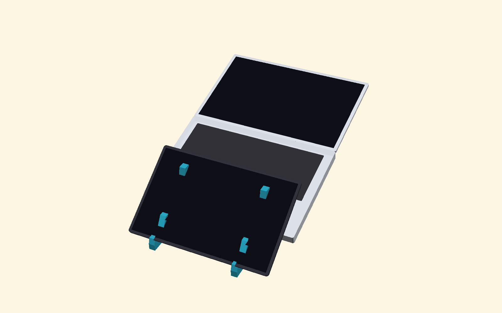
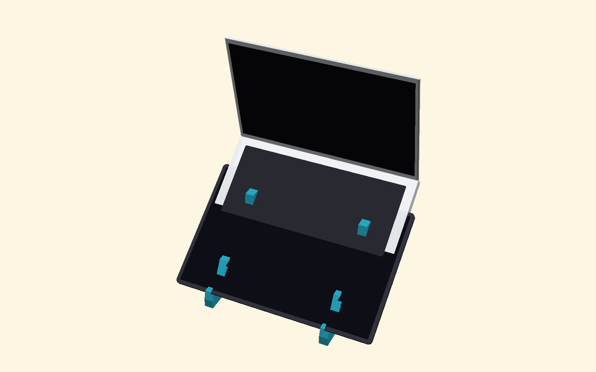
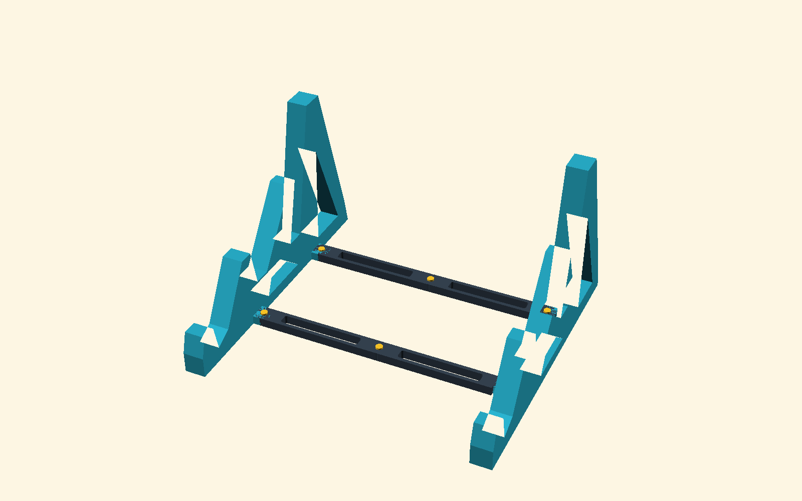
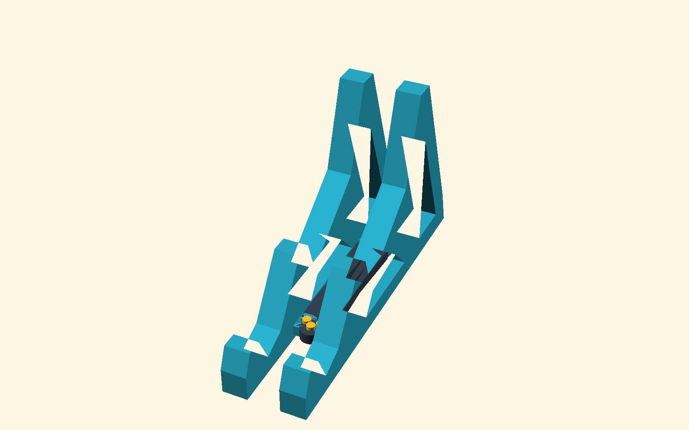

# Soporte Dual Escalonado Plegable para Laptop y Tablet (V1)

Esta carpeta (`v1/`) contiene la **Versión 1 (V1)** del soporte dual escalonado para laptop y tablet, **impresa en 3D y probada físicamente**, incluyendo las barras articuladas tipo tijera (plegado hasta 15° sin colisión) y el sistema de pasadores enrasados (`flush_bracket_pin`) y autoblocantes (`snap_pin`).

---

## 📸 Vistas del Diseño V1

| Modo Dell Latitude 7650 Vertical (75°) | Modo MacBook Pro 13" Ergonómico (38°) |
| :---: | :---: |
|  |  |

| Estructura Abierta con 3 Ranuras | Soporte Plegado Compacto |
| :---: | :---: |
|  |  |

---

## 🧩 Piezas y Archivos del Soporte (`v1/`)

### 1. Proyecto de Impresión Directa (`.3mf`)
- **[`soporte-laptop.3mf`](soporte-laptop.3mf)**: Archivo de proyecto para Bambu Studio actualizado con los modelos de la Versión 1:
  - **Plato 1**: Bandeja completa ([`stl/single_plate_complete.stl`](stl/single_plate_complete.stl)) con los 2 soportes laterales de 3 ranuras, las 4 barras articuladas tipo tijera y el juego de pasadores enrasados y snap-fit.
  - **Plato 2**: Bandeja dedicada de accesorios plegables ([`stl/plate_accessories_folding.stl`](stl/plate_accessories_folding.stl)) con las 4 barras tijera, 4 pasadores enrasados de base, 2 pasadores snap-fit centrales y el juego alternativo de pasadores con C-clip.

### 2. Soportes Laterales (3 Ranuras Independientes)
- **Código fuente OpenSCAD**: [`src/bracket.scad`](src/bracket.scad)
- **Archivos STL individuales**:
  - [`stl/bracket_left.stl`](stl/bracket_left.stl) (Lateral Izquierdo)
  - [`stl/bracket_right.stl`](stl/bracket_right.stl) (Lateral Derecho)
- **Características**:
  - **Ranura 1 (Frontal, 55°, 16 mm)**: Para Samsung Galaxy Tab S11 Ultra (14.6").
  - **Ranura 2 (Media, 38°, 28 mm)**: Rampa ergonómica para MacBook Pro 13" (apertura hasta 135°).
  - **Ranura 3 (Trasera, 75°, 28 mm)**: Ranura casi vertical para Dell Latitude 7650 (16", apertura a 180°).

### 3. Barras Articuladas Tipo Tijera (Plegado hasta 15° sin colisión)
- **Código fuente OpenSCAD**: [`src/folding_link.scad`](src/folding_link.scad)
- **Archivo STL**: [`stl/folding_links_x4.stl`](stl/folding_links_x4.stl)
  - Incluye 2x `folding_link_half_A` (piso inferior) y 2x `folding_link_half_B_printable` (piso superior invertido para imprimirse plano 100% sin soportes).
  - Radio exterior $R = 4.2\text{ mm}$ que deja $0.8\text{ mm}$ de holgura libre con la pared de los soportes laterales.

### 4. Pasadores Enrasados y Snap-Fit (Cero saliente inferior)
- **Código fuente OpenSCAD**: [`src/printed_pin.scad`](src/printed_pin.scad) y [`src/plate_flush_pins_x4.scad`](src/plate_flush_pins_x4.scad)
- **Archivos STL**:
  - [`stl/flush_pins_x4.stl`](stl/flush_pins_x4.stl): **Los 4 pasadores enrasados (`flush_bracket_pin`)** para las orejetas de la base. Se insertan de arriba hacia abajo y terminan $0.7\text{ mm}$ antes de tocar la mesa para que el soporte descanse 100% plano sin inclinarse.
  - [`stl/pins_and_clips.stl`](stl/pins_and_clips.stl): Colección de pasadores `snap_pin` (autoblocantes para la unión central de las barras) y `hinge_pin_grip` con `retainer_clip`.

### 5. Bandejas Completas y Opciones Rígidas
- [`stl/plate_accessories_folding.stl`](stl/plate_accessories_folding.stl) (desde [`src/plate_accessories_folding.scad`](src/plate_accessories_folding.scad)): Bandeja completa de barras tijera + pasadores enrasados + snap-fit + C-clips.
- [`stl/single_plate_complete.stl`](stl/single_plate_complete.stl) (desde [`src/print_plate.scad`](src/print_plate.scad)): Todo el soporte completo en una sola cama de 256×256 mm.
- *(Opcional)* Travesaños fijos rígidos: [`stl/rigid_crossbars_x2.stl`](stl/rigid_crossbars_x2.stl) y [`stl/plate_accessories_rigid.stl`](stl/plate_accessories_rigid.stl) (desde [`src/rigid_crossbar.scad`](src/rigid_crossbar.scad)).

---

## 🛠️ Regeneración de Archivos STL

Desde esta carpeta (`v1/`), puedes regenerar todos los archivos STL ejecutando:

```bash
python3 export_all.py
```
